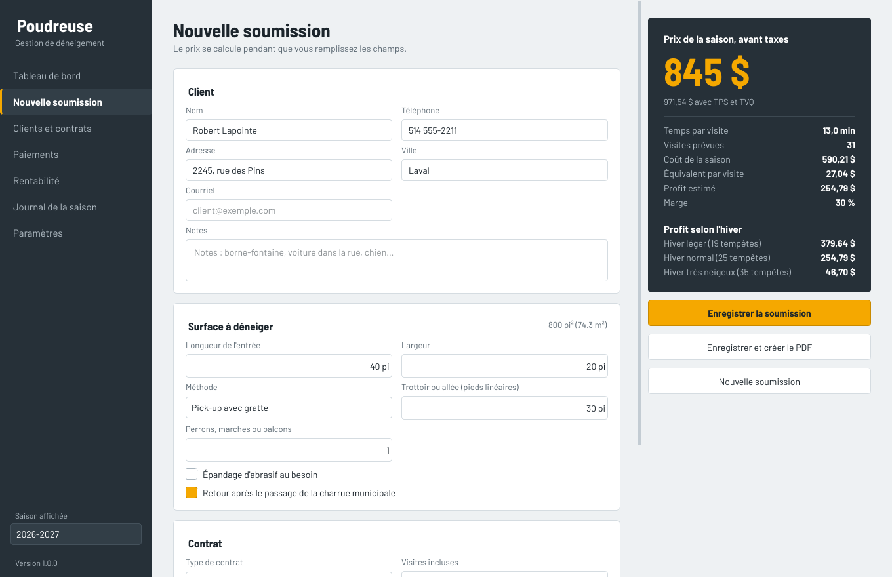
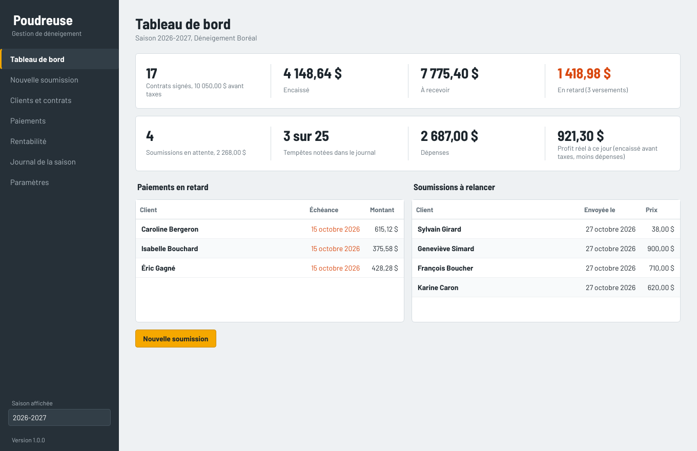
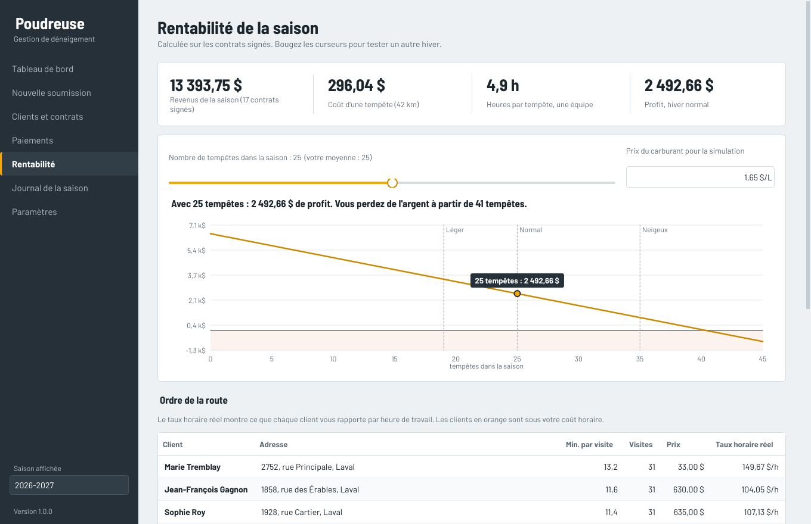
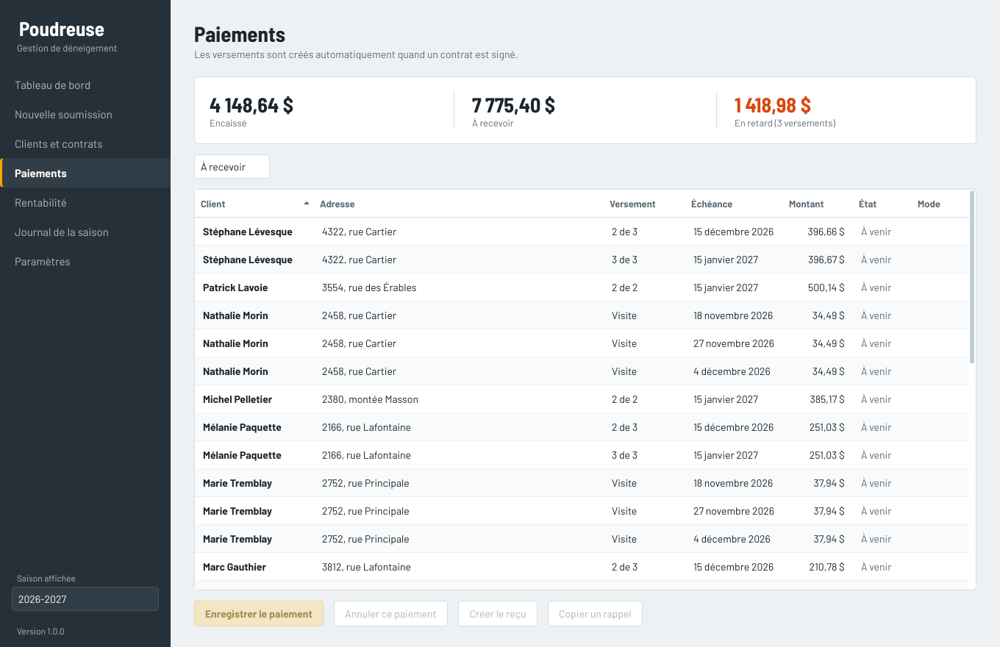
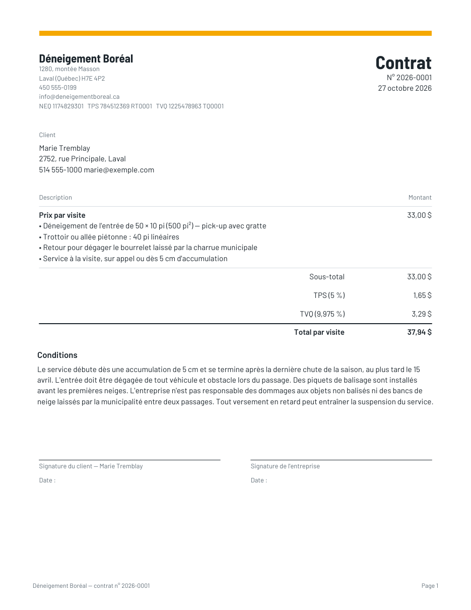

# Poudreuse

Logiciel de gestion pour les entreprises de déneigement du Québec : soumissions, contrats, paiements et rentabilité de la saison, en français, avec la TPS et la TVQ.



## Ce que fait Poudreuse

**Soumissions en direct.** Entrez les dimensions de l'entrée, la méthode (tracteur, pick-up, souffleuse, pelle), le trottoir, les perrons et les options. Le prix suggéré se calcule pendant la saisie à partir de vos vrais coûts : salaire, équipement, carburant, abrasif, frais fixes et marge visée. Vous voyez aussi le profit selon un hiver léger, normal ou très neigeux.

**Trois types de contrat.** Saisonnier à visites illimitées, saisonnier avec un nombre de visites incluses, ou à la visite.

**Documents PDF.** Soumission, contrat et reçu de paiement avec votre logo, vos numéros de TPS, TVQ et NEQ, l'échéancier des versements, vos conditions et les lignes de signature.

**Paiements.** Les versements (1 à 4) sont créés automatiquement à la signature. Les retards ressortent en orange, et un bouton copie un rappel prêt à coller dans un texto ou un courriel. Les clients à la visite sont facturés automatiquement à chaque tempête notée dans le journal.

**Rentabilité de la saison.** Revenus, coût d'une tempête, heures de route et nombre d'équipes nécessaires. Une courbe montre votre profit selon le nombre de tempêtes, et à partir de combien de tempêtes vous perdez de l'argent. Le tableau de la route affiche le taux horaire réel de chaque client pour repérer ceux qui ne sont pas rentables.

**Journal de la saison.** Tempêtes (date, centimètres, heures) et dépenses par catégorie, pour connaître votre vrai profit à ce jour.

**Vos données restent chez vous.** Tout est enregistré dans un seul fichier sur l'ordinateur, avec copie de sauvegarde et restauration en un clic, et export des contrats en CSV pour Excel.

| Tableau de bord | Rentabilité |
|---|---|
|  |  |
| **Paiements** | **Contrat en PDF** |
|  |  |

## Télécharger le programme Windows

Le fichier `Poudreuse.exe` est fabriqué automatiquement par GitHub à chaque modification du code.

1. Ouvrez l'onglet **Actions** du dépôt.
2. Cliquez sur la dernière exécution réussie de **Compiler Poudreuse.exe** (coche verte).
3. En bas de la page, dans **Artifacts**, téléchargez **Poudreuse-windows**, puis décompressez-le.

Pour publier une version officielle dans l'onglet **Releases**, créez une étiquette commençant par `v` (par exemple `v1.0.0`) : GitHub y joint l'exécutable.

Au premier lancement, Windows peut afficher « Windows a protégé votre ordinateur », car le programme n'est pas signé numériquement. Cliquez sur **Informations complémentaires**, puis **Exécuter quand même**. Pour vendre le logiciel à grande échelle, un certificat de signature de code fait disparaître cet avertissement.

## Premiers pas

1. Allez dans **Paramètres** et entrez le nom de votre entreprise, vos coordonnées et vos numéros de taxes.
2. Ajustez vos coûts : salaire horaire, coût de l'équipement, carburant, frais fixes et nombre de clients prévus. Les prix suggérés en dépendent directement.
3. Pour découvrir le logiciel sans rien saisir, cliquez sur **Essayer avec des clients fictifs** (dans un logiciel vide seulement).
4. Créez une **Nouvelle soumission**, puis créez le PDF ou marquez-la comme signée dans **Clients et contrats**.

Les données sont enregistrées dans `%APPDATA%\Poudreuse\poudreuse.db` et les PDF dans `Documents\Poudreuse`.

## Pour les développeurs

Lancer depuis le code (Python 3.11 ou plus récent) :

```
pip install -r requirements.txt
python main.py
```

Lancer les tests :

```
pip install pytest
python -m pytest
```

Compiler le .exe sur votre propre PC Windows : double-cliquez sur `construire.bat`. Le programme apparaît dans `dist\Poudreuse.exe`.

### Organisation du code

| Fichier | Rôle |
|---|---|
| `poudreuse/calculs.py` | Moteur de prix, taxes, versements et rentabilité (sans interface, entièrement testé) |
| `poudreuse/donnees.py` | Base de données SQLite locale |
| `poudreuse/pdf.py` | Soumissions, contrats et reçus en PDF |
| `poudreuse/app.py` | Fenêtre principale et navigation |
| `poudreuse/pages/` | Une page par écran |
| `poudreuse/theme.py` | Couleurs, police et style |
| `.github/workflows/compiler-exe.yml` | Compilation automatique du .exe sur GitHub |

La police Barlow est distribuée sous licence SIL Open Font License (voir `poudreuse/ressources/polices/OFL.txt`).
